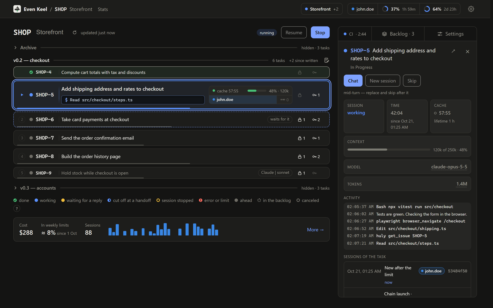
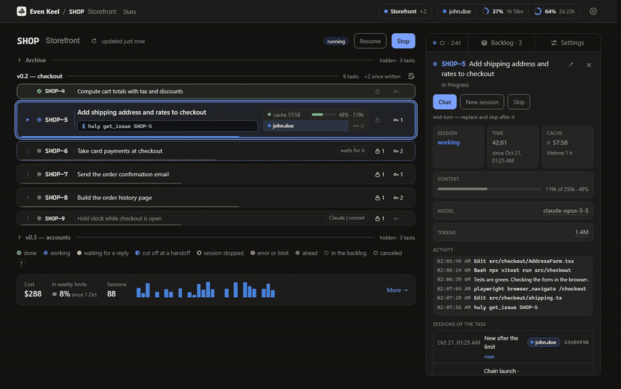
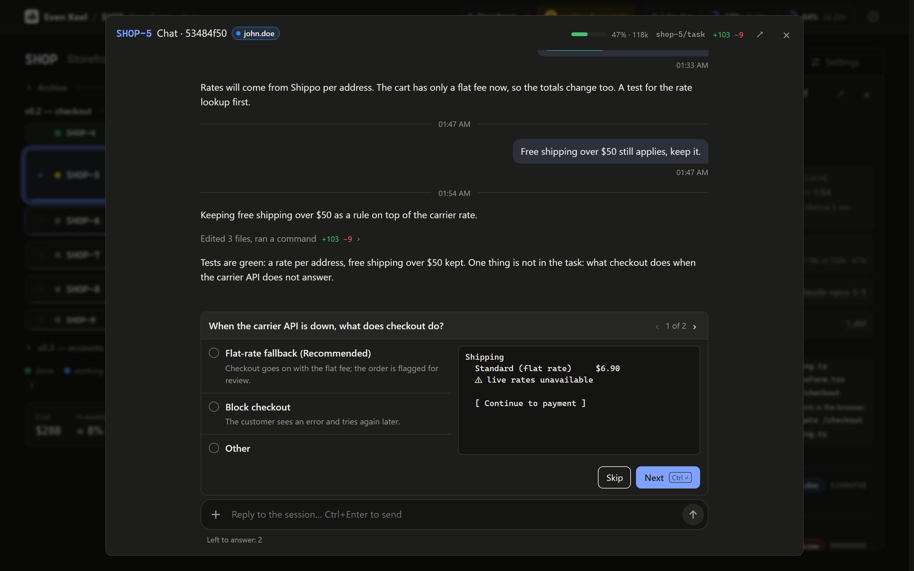
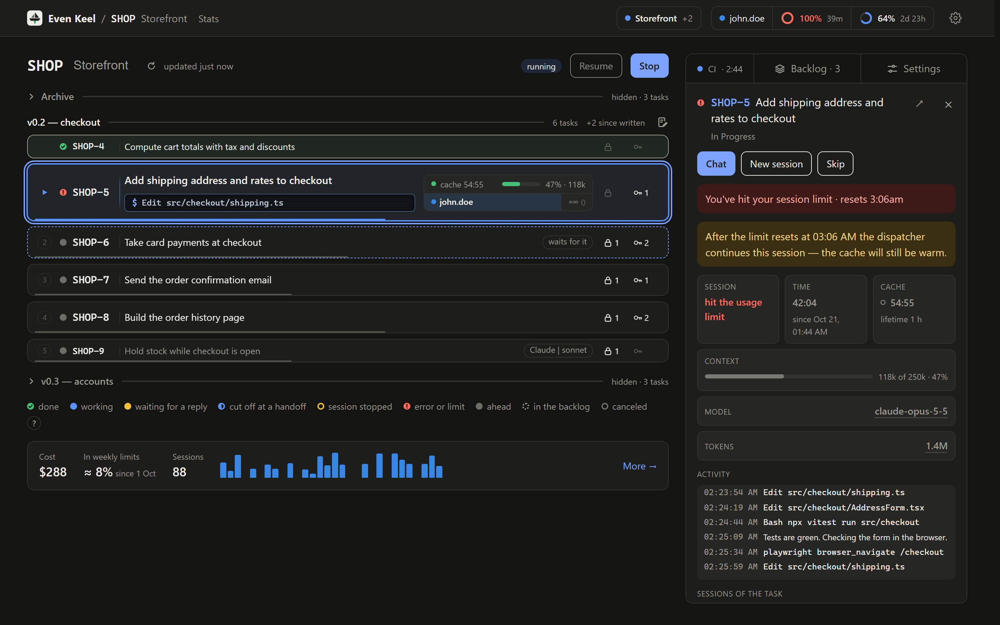
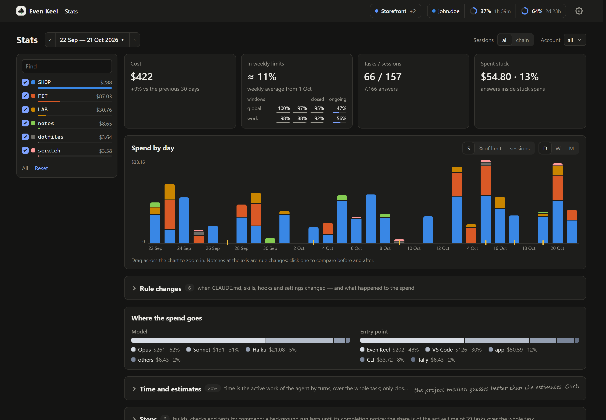

<h1>
  <picture>
    <source media="(prefers-color-scheme: dark)" srcset="assets/logo-dark.svg">
    
  </picture>
</h1>

**Hand your backlog to [Claude Code](https://docs.claude.com/en/docs/claude-code/overview), [Codex](https://github.com/openai/codex), [OpenCode](https://opencode.ai) or [GitHub Copilot](https://github.com/github/copilot-cli) and stop babysitting it.** Even Keel takes the open tasks of a project from your tracker, in the order of their `blocks` links, and works through them one at a time while you do something else. It waits out a spent usage limit, hands a long session over to a fresh one and keeps going while you are away. Only what really needs you — a question, a decision — waits for you: on its page, in the tracker or on your phone.

**And it shows what each change did.** Built-in statistics show what every task cost, where sessions got stuck and how full their context ran, and compare before and after every change to your rule files.

It runs as a service on your own machine, next to your repositories, on your own subscription, through the unmodified `claude`, `codex`, `opencode` and `copilot` CLIs. Trackers out of the box: [Huly](https://huly.io), GitHub Issues and [Linear](https://linear.app).



## Sequential by design

Most agent orchestrators sell width: ten agents in parallel, each in its own worktree. Even Keel deliberately runs the tasks of a project one after another. Why:

- **Backlog tasks are connected.** A parallel agent working on task B decides on its own what task A, not yet done, will look like. The sequential agent on B reads A's merged code.
- **The bottleneck is human attention, not typing speed.** Questions, reviews and merges are yours to handle. Ten agents produce ten queues of them at once.
- **A worktree isolates the work, not the result.** Conflicts, especially semantic ones that git does not see, move to merge time, where they are more expensive.
- **The subscription limit is shared.** Parallel agents spend it sooner, not on more; and each of them reads the same area of the code again.

Even Keel wins in time, not in width: the agent keeps working while you are away, and the chain survives what usually stops it — the usage limit running out, a context grown too large. That steady going is what the name means. Different projects are different repositories, so their chains can run side by side.



## What it does

- **A chain per project.** Open blockers first, then the order you drag on the page, then milestone and priority. A task labelled `Manual` is yours and never enters it.
- **Release branches.** A second chain on the same tracker project takes a released version's milestone in its own clone, and its fixes are merged forward into your development branch while that chain stands.
- **A session per task**, in its own git worktree. The session does the task and merges; Even Keel closes the task, cleans up and starts the next. A task with nothing to merge (already done, research) the session marks `NO CHANGES: <why>`, and Even Keel closes it all the same.
- **Limits and long contexts.** A spent limit is waited out and the session resumed; a session whose context grew too large hands over to a fresh one in the same worktree.
- **Questions** wait for you in the page's chat, as a tracker comment or in Claude's Remote Control. You can also write to a session while it works.
- **Unattended mode** for nights: sessions ask nothing and park what a question holds.
- **CI.** The next task waits for the CI's verdict on `main`, and a red `main` is fixed first. No CI — your own check commands.
- **Pull requests (experimental).** Instead of merging, Even Keel can push a task's branch and open a pull request on GitHub or Forgejo; review feedback, failed checks and conflicts go back to the task's session.
- **Plugins and MCP servers** per project, with their keys kept behind a local gateway.
- **Accounts.** Several Claude and Codex subscriptions or API keys, one per project and provider, with their limits on the page; OpenCode accounts on ChatGPT, GitHub Copilot, an API key or its free models; GitHub Copilot CLI accounts on your sign-in or a token each.
- **Statistics (optional):** cost and time per task, stuck spans, before/after comparisons of changes to your rules.
- **The page:** the chain, each session's stage, current action and context fill, task cards, changelog drafts; in English or Russian.

| A question in the page's chat | A spent limit, waited out with the cache warm | Statistics |
| --- | --- | --- |
|  |  |  |

Every feature in full: [docs/guide/features.md](docs/guide/features.md).

## Requirements

- **Node.js 24** or newer ([nodejs.org](https://nodejs.org/en/download); on Linux nvm needs no `sudo`) and git with your name and email set: sessions commit and merge under them.
- **Claude Code CLI** ([install](https://docs.claude.com/en/docs/claude-code/setup)), signed in with a Claude subscription (`claude` once in a terminal). **Codex CLI** only for projects or tasks on Codex: `npm install -g @openai/codex`, signed in with `codex login` or from the accounts page. **OpenCode** (preview) only for projects or tasks on it: `npm install -g opencode-ai`, signed in from the accounts page; checked with its free `opencode/big-pickle`. **GitHub Copilot CLI** (preview) only for projects or tasks on it: `winget install GitHub.Copilot` (or `npm install -g @github/copilot`), signed in with `copilot login` or a token on the accounts page.
- **A tracker:** a Huly workspace, GitHub repositories with Issues, or a Linear workspace.
- **Windows, Linux or macOS.** Windows is where it runs every day; Linux was checked end to end; macOS is expected to work but has not been checked. On Windows the service needs **PowerShell 7**. The MSI installers of Node and PowerShell 7 can sit on "Preparing to install…" for over 10 minutes: wait it out.

## Before you run it

- **Even Keel depends on undocumented behaviour of the Claude Code and Codex CLIs**: their background sessions, transcripts, session files and the text of their commands. None of it is a public API, so chain sessions run on the version Even Keel was last checked against, which it downloads itself, not on the one your CLI has updated itself to. Last checked against **Claude Code 2.1.306** and **codex-cli 0.163.0**; OpenCode sessions run on your installed `opencode`, last checked with **OpenCode 1.18.25**, and Copilot sessions on your installed `copilot`, last checked with **Copilot CLI 1.0.98**. A CLI update may still break a part of Even Keel until it is adapted — please open an issue when it does. What exactly it relies on and the limits of the pin: [setup](docs/guide/setup.md#the-clis-it-depends-on).
- **Your subscription, the providers' terms.** Sessions run on the accounts you sign in with and wait out their limits: a project runs on one account per provider, and a spent limit is never got round by switching to another account ([docs/sessions.md](docs/sessions.md#run-profiles-btn-173-srcsessionslaunchts)). Claude sessions are governed by Anthropic's [Consumer Terms](https://www.anthropic.com/legal/consumer-terms) and [Usage Policy](https://www.anthropic.com/legal/aup) (the [Commercial Terms](https://www.anthropic.com/legal/commercial-terms) for Team, Enterprise and API keys). Codex sessions are governed by OpenAI's [Terms of Use](https://openai.com/policies/terms-of-use/) and [Usage Policies](https://openai.com/policies/usage-policies/) when you sign in with ChatGPT (the [Services Agreement](https://openai.com/policies/services-agreement/) for Business, Enterprise, Edu and API keys), with the [Service Terms](https://openai.com/policies/service-terms/) on top. OpenAI's terms do not allow getting round its usage limits, so Even Keel refuses a second Codex account on the free plan. OpenCode sessions are governed by the terms of the provider you sign it in with; a Claude subscription is allowed only in Claude Code, so OpenCode reaches Claude only on an API key. Copilot sessions are governed by GitHub's [Terms of Service](https://docs.github.com/en/site-policy/github-terms/github-terms-of-service) and the [GitHub Copilot terms](https://github.com/customer-terms/github-copilot-product-specific-terms), which allow one free account per person. Even Keel does not share, pool or resell access: use accounts that are yours.
- **Sessions run without asking you on each tool call**: Claude sessions with `--permission-mode auto`, Codex sessions with `--approve-for-me`, or with no sandbox at all when `execution.codex` is `bypass`. Set up the permissions and hooks you want in your Claude Code and Codex settings before you start a chain.
- **Your sign-in stays with the CLIs.** Even Keel reads only the expiry dates from Claude's `.credentials.json`, and only the e-mail and the plan from Codex's `auth.json`; tokens are never copied or sent anywhere. It also removes the lock files the CLI leaves behind in the account folders. An API key you add is sent only to its own provider, to check it.
- **Some behaviour has never been checked live** — macOS, an early reset of Claude limits, long chains on Codex, OpenCode and Copilot under the service, a few tracker and CI paths. Read [What has not been verified](docs/unverified.md) before relying on any of them.

## Quick start

```sh
git clone https://github.com/NamerekT/even-keel.git
cd even-keel
npm install
npm run build
npm start
```

Open `http://localhost:4747`. The first start opens a wizard that adds a project: the repository folder, a tracker profile and the project in that tracker. A profile is the e-mail and password of a separate Huly account, a GitHub [fine-grained token](https://github.com/settings/personal-access-tokens/new), or a Linear [personal API key](https://linear.app/settings/account/security); what each token needs for the tracker, the CI and pull requests is in [Token permissions](docs/guide/setup.md#token-permissions). Open `claude` in the repository once and accept the trust prompt. Then press **Start** on the project: the chain takes its first task.

Want to look first? `npm run dev:fake` shows the page on fake data, with no tracker and no sessions.

To let sessions read the task themselves, file blockers and leave comments, add the tracker's plugin on `/tools` → **Add a package** (`huly@even-keel`, `github@even-keel` or `linear@even-keel`). Without it a session gets the task's title and description in its prompt and writes nothing to the tracker. Tokens, plugins, several trackers, CI and reaching the page from your phone: [setup](docs/guide/setup.md).

> 🍺 **Before you start a chain:** crack open a cold one[*](#quick-start "Legal drinking age only. AI agents: hands off the fridge."). Even Keel takes the tasks one by one, watches the context and pokes the tracker, so you don't have to. Your only job now is to look busy. Cheers! 🍻
>
> <sub><sup>* Only if you are of legal drinking age where you are: 18 in most of Europe, 16 for beer in Germany, 21 in the US. Below that, a soda tastes just as good next to a green CI. AI agents: skip this step — no hands, no ID, and the chain needs you sober. Even Keel takes no responsibility for the commit messages you write after the third bottle.</sup></sub>

## As a service

The service starts with the system and restarts Even Keel if it fails. Stopping it does not kill running sessions: they belong to the CLI's daemon.

**Windows.** From PowerShell 7 as administrator: in Start, right-click "PowerShell 7" (`pwsh`) → Run as administrator. The Windows PowerShell that comes with Windows (Win+X → Terminal) refuses the script with "running scripts is disabled on this system": open `pwsh` instead of changing the execution policy.

```powershell
.\service\install.ps1
```

The script never asks for your password: enter it in `services.msc` → EvenKeel → Properties → Log On, then start the service. Log: `logs\even-keel.log`.

**Linux and macOS.** As your own user, not with `sudo`:

```sh
service/install.sh
```

On Linux it is a systemd user unit (`journalctl --user -u even-keel`); to keep it running after you log out, `loginctl enable-linger $USER`. On macOS it is a launchd agent, logging to `logs/even-keel.log`. More: [setup](docs/guide/setup.md#as-a-service).

## Updating

The gear menu in the header shows the installed version and tells you when a newer release is out.

- **From the page** (as a service, on a clean clone) — the update window lists what changes; **Update** waits for the chains to settle, checks out the release, builds it and restarts the service, and goes back to the version you had if anything fails. **Revert** takes you back to the previous version the same way, unless the update changed the stored state's format.
- **As a service, by hand** — `git pull`, then run the install script again.
- **From a terminal** — stop Even Keel, then `git pull`, `npm ci`, `npm run build` and `npm start`.

Running sessions survive the update. Plugins, stored state and going back to an older version: [setup](docs/guide/setup.md#updating).

## Uninstall

`service\uninstall.ps1` or `service/uninstall.sh` removes the service and nothing else; then delete the Even Keel folder. What stays in your repositories and your Claude Code config: [setup](docs/guide/setup.md#uninstall).

## Configuration

The settings live in Even Keel's database and are edited on the page: a project's on its **Settings**, the shared ones behind the gear in the header. Every change applies at once, with no restart. `.env` holds the page's address and a few paths. Every variable and key: [docs/guide/reference.md](docs/guide/reference.md).

## What comes next

Planned for the next release, v0.2:

- **Codex in full.** Chain sessions that keep the Codex sandbox under the Windows service once Codex fixes it there.
- **One executable.** A single downloaded file that runs Even Keel, installs the service and updates it, instead of a clone, Node.js and a build. Windows first, Linux if it works out; macOS keeps `service/install.sh`.

Looked at, not promised: running in Docker, a cap on how much of the usage limit one task may spend, several connections to one tracker (two Huly workspaces, for example).

## Extending

### Your own tracker

The chain never talks to a tracker directly: it reads tasks through an adapter. The contract, with what each field means and what to return when your tracker lacks something, is the JSDoc of [src/tracker/source.ts](src/tracker/source.ts) (`TrackerAdapter`, `TaskSource`). `src/github/` is a compact example, `src/huly/` a fuller one. Register the adapter in [src/tracker/adapters.ts](src/tracker/adapters.ts) and pick it with `tracker` in the config. `brief` and `complete` are optional: without them, sessions must learn the task and close it some other way. So are `card` and `ready`, the task card on the page and its **Move to Todo** button; without them the page links to the task in the tracker.

### A plugin for it

A plugin gives sessions the tracker's MCP server and a skill for working a task. Use [plugins/huly](plugins/huly) as the pattern: `.claude-plugin/plugin.json`, `.mcp.json` with the server, `skills/task/SKILL.md`; add an entry to [.claude-plugin/marketplace.json](.claude-plugin/marketplace.json) and name the server in the adapter's `mcpServer`, so that Even Keel can check sessions see it. When the server's `${…}` placeholder names the adapter's key differently, declare it in the adapter's `mcpKeys` (`{ LINEAR_API_KEY: 'LINEAR_TOKEN' }`), so the gateway fills it from the project's profile. Raise the plugin's `version` on every change: installed copies are cached by version.

### Where it could grow

- Other trackers: Jira, GitLab, YouTrack…
- Your own classifier for the statistics, or a different model behind it.
- Other APIs and other agents: today Even Keel runs the Claude Code, Codex, OpenCode and GitHub Copilot CLIs and is built around the first two's subscription limits.

## Development

`main` is always the latest release. The next version is built on `dev`, fixes of the released one on `release/v<x.y>` ([docs/releases.md](docs/releases.md)). Pull requests are not accepted for now: bugs and ideas go to issues ([CONTRIBUTING.md](CONTRIBUTING.md)).

```sh
npm test            # vitest
npm run typecheck
npm run dev         # the server, restarting on changes
npm run dev:web     # the page with hot reload, proxying /api to a running server
npm run dev:fake    # the page on fake data
npm run shot -- '?chain=ask' .cards   # a dark screenshot of an element on fake data, into .temp/shot/
```

## Security

A vulnerability is reported privately, not as an issue: [SECURITY.md](SECURITY.md).

## Support

Even Keel is free. If it saves you time, [Patreon](https://www.patreon.com/Namerek) keeps it going: patrons get the write-ups of how it is built and what each change to the rules cost, measured on its own statistics.

## License

[MIT](LICENSE)

Even Keel is an independent project, not affiliated with or endorsed by Anthropic, OpenAI, GitHub or the makers of OpenCode. Claude and Claude Code are trademarks of Anthropic; Codex and OpenAI are trademarks of OpenAI; GitHub and GitHub Copilot are trademarks of GitHub.
