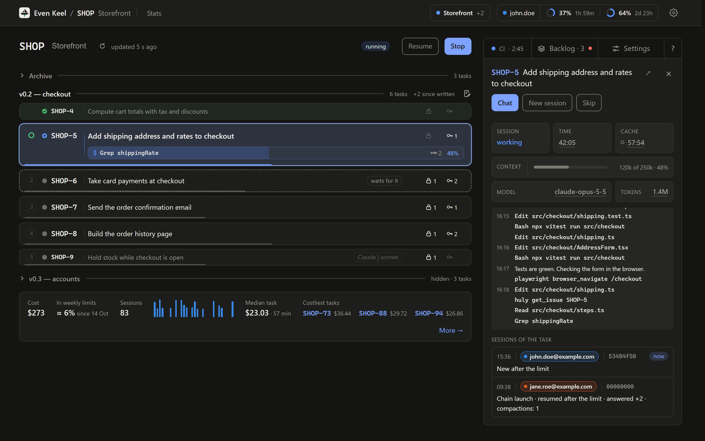
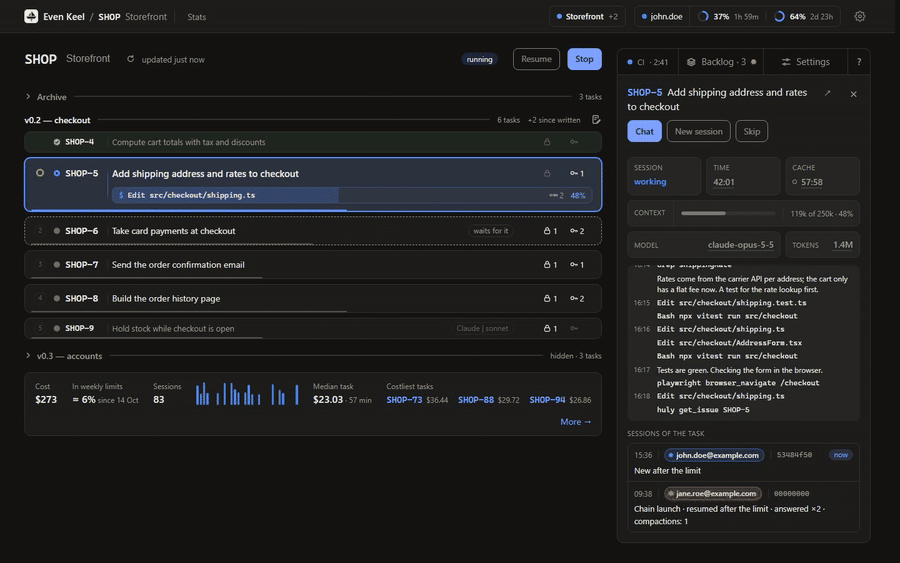
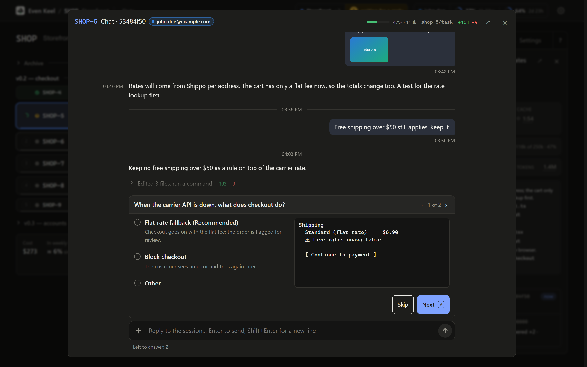
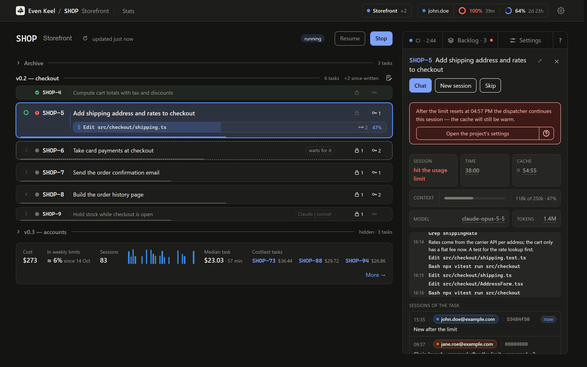
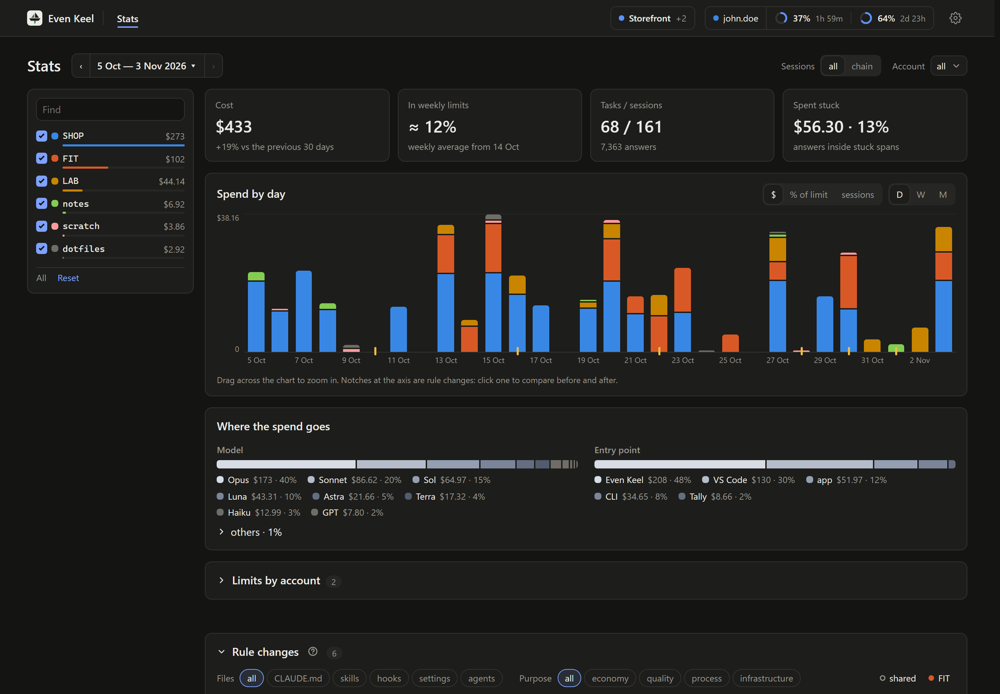

<h1>
  <picture>
    <source media="(prefers-color-scheme: dark)" srcset="assets/logo-dark.svg">
    
  </picture>
</h1>

**You write the tickets. It takes the night shift.** Even Keel takes the open tasks of a project from your tracker, in the order of their `blocks` links, and works through them one at a time with [Claude Code](https://docs.claude.com/en/docs/claude-code/overview), [Codex](https://github.com/openai/codex), [OpenCode](https://opencode.ai) or [GitHub Copilot](https://github.com/github/copilot-cli) while you do something else. It waits out a spent usage limit, hands a long session over to a fresh one and keeps going while you are away. Only what really needs you — a question, a decision — waits for you: on its page, in the tracker or on your phone.

**Already inside, so you don't glue five tools together:**

- **Usage limits.** A spent 5-hour or weekly limit is waited out: the session is resumed after the reset while its prompt cache is warm, or handed to a fresh one — no work lost, no 3 a.m. restart.
- **A full context, your way.** A session past its context threshold writes a handoff note and a fresh one takes over in the same worktree — or leaves it to Claude Code's auto-compact, per project or per task by a [label](docs/guide/reference.md#configuration). The statistics count both, so you can compare what each cost on your own tasks.
- **What each task cost.** Built-in statistics (optional): cost and time per task, where sessions got stuck, how full the context ran, and before/after every change to your rule files. A session audit skill reads them and proposes what to change in your rules.
- **Every account on one page.** Claude, Codex, OpenCode and Copilot — subscriptions and API keys — each with its limits or spend and what runs on it right now. You pick the account a project runs on.
- **`CLAUDE.md` or `AGENTS.md`.** One instruction file reaches every agent: Claude Code gets your `AGENTS.md`, Codex your `CLAUDE.md`.

It runs as a service on your own machine, next to your repositories, on your own subscription, through the unmodified `claude`, `codex`, `opencode` and `copilot` CLIs. Trackers out of the box: [Huly](https://huly.io), GitHub Issues, [Linear](https://linear.app), GitLab Issues (GitLab.com or your own server) and Jira Cloud.



## Sequential by design

Most agent orchestrators sell width: ten agents in parallel, each in its own worktree. Even Keel deliberately runs the tasks of a project one after another. Why:

- **Backlog tasks are connected.** A parallel agent working on task B decides on its own what task A, not yet done, will look like. The sequential agent on B reads A's merged code.
- **The bottleneck is human attention, not typing speed.** Questions, reviews and merges are yours to handle. Ten agents produce ten queues of them at once.
- **A worktree isolates the work, not the result.** Conflicts, especially semantic ones that git does not see, move to merge time, where they are more expensive.
- **The subscription limit is shared.** Parallel agents spend it sooner, not on more; and each of them reads the same area of the code again.

Even Keel wins in time, not in width: the agent keeps working while you are away, and the chain survives what usually stops it — the usage limit running out, a context grown too large. That steady going is what the name means. One task at a time holds per folder, not per repository: different projects, or a second clone of the same repository on another branch, have chains of their own that run side by side.



## What it does

- **A chain per project**, ordered by blockers first, then the order you drag on the page, then milestone and priority. A task labelled `Manual` stays yours.
- **A session per task**, in its own git worktree. It does the task and merges; Even Keel closes the task and starts the next.
- **Several trackers in one chain**, say the GitHub issues others file next to your private Huly project; or **several chains on one tracker project**, say fixes of a released version beside the next one.
- **Unattended mode** for nights: a task that needs your answer is left on its branch with the question, and the chain moves on.
- **CI.** The next task waits for a green main branch, and a red one is fixed first.
- **Pull requests** instead of merging, on GitHub, Forgejo or GitLab; review feedback goes back to the session.
- **Plugins and MCP servers** per project, their keys kept away from the sessions.
- **Protection.** Destructive commands are refused for every agent by default.
- **Standards.** A guide of yours, say for the UI files, reaches a session when it touches them and can hold the merge until its checks are done.
- **The page:** the chain, each session's stage, current action and context fill; in English or Russian.

| A question in the page's chat | A spent limit, waited out with the cache warm | Statistics |
| --- | --- | --- |
|  |  |  |

Every feature in full: [docs/guide/features.md](docs/guide/features.md).

## Requirements

- **Node.js 24** or newer ([nodejs.org](https://nodejs.org/en/download); on Linux nvm needs no `sudo`).
- **git** ([git-scm.com](https://git-scm.com/downloads)) with your name and e-mail set (`git config --global user.name` and `user.email`): sessions commit and merge under that name.
- **An agent and an account of it:** [Claude Code](https://docs.claude.com/en/docs/claude-code/setup), [Codex](https://github.com/openai/codex), [OpenCode](https://opencode.ai) (preview) or [GitHub Copilot CLI](https://github.com/github/copilot-cli) (preview), on a subscription or an API key; OpenCode also runs its free models. The setup can download the CLI for you.
- **A tracker:** a Huly workspace, GitHub or GitLab projects with Issues, a Linear workspace or a Jira Cloud site.
- **Windows, Linux or macOS.** Windows is where it runs every day; Linux and macOS (Apple silicon) were checked end to end. The MSI installer of Node can sit on "Preparing to install…" for over 10 minutes: wait it out.

## Before you run it

- **Even Keel depends on undocumented behaviour of the agents' CLIs**, none of it a public API. Last checked against **Claude Code 2.1.319**, **codex-cli 0.167.0**, **OpenCode 1.19.5** and **Copilot CLI 1.0.106**; the page warns when yours is another version and can run sessions on the checked one instead. A CLI update may break a part of Even Keel until it is adapted — please open an issue when it does. Details: [setup](docs/guide/setup.md#the-clis-it-depends-on).
- **Your subscription, the providers' terms.** A project runs on one account per provider, and a spent limit is waited out, never got round by switching accounts. Even Keel does not share, pool or resell access. Each agent's sessions fall under its provider's terms, listed below.
- **Sessions don't ask you before each tool call** (Claude in auto mode, Codex with `--approve-for-me` or, if you choose, with no sandbox). Protection refuses destructive commands; set up any other permissions and hooks in your agents' settings before you start a chain.
- **Your sign-in stays with the CLIs.** Even Keel reads only expiry dates, the e-mail and the plan; tokens are never copied or sent anywhere. An API key you add goes only to its own provider.
- **Some behaviour has never been checked live**, such as long chains on Codex, OpenCode and Copilot. Read [What has not been verified](docs/unverified.md) before relying on it; every live check is logged in [What has been verified](docs/verified.md).

<details>
<summary>The providers' terms</summary>

- **Claude** sessions are governed by Anthropic's [Consumer Terms](https://www.anthropic.com/legal/consumer-terms) and [Usage Policy](https://www.anthropic.com/legal/aup) (the [Commercial Terms](https://www.anthropic.com/legal/commercial-terms) for Team, Enterprise and API keys). Anthropic asks products built on the Agent SDK to [use API key authentication](https://code.claude.com/docs/en/legal-and-compliance), so a subscription runs on the CLI's own background sessions unless you switch its card to the SDK yourself.
- **Codex** sessions are governed by OpenAI's [Terms of Use](https://openai.com/policies/terms-of-use/) and [Usage Policies](https://openai.com/policies/usage-policies/) when you sign in with ChatGPT (the [Services Agreement](https://openai.com/policies/services-agreement/) for Business, Enterprise, Edu and API keys), with the [Service Terms](https://openai.com/policies/service-terms/) on top. OpenAI's terms do not allow getting round its usage limits, so Even Keel refuses a second Codex account on the free plan.
- **OpenCode** sessions are governed by the terms of the provider you sign it in with; a Claude subscription is allowed only in Claude Code, so OpenCode reaches Claude only on an API key.
- **Copilot** sessions are governed by GitHub's [Terms of Service](https://docs.github.com/en/site-policy/github-terms/github-terms-of-service) and the [GitHub Copilot terms](https://github.com/customer-terms/github-copilot-product-specific-terms), which allow one free account per person.

</details>

## Quick start

```sh
npx even-keel
```

This installs Even Keel globally with npm and sets it up as a service ([below](#as-a-service)), no administrator needed. In PowerShell add `.cmd` to it and to every `even-keel` command, or run them from cmd ([why](docs/guide/setup.md#windows-powershell)):

```powershell
npx.cmd even-keel
```

To run it in a terminal instead of as a service:

```sh
npm install --global even-keel
even-keel
```

Its data — `.env`, the state and the logs — lives in `%LOCALAPPDATA%\even-keel`, `~/.local/share/even-keel` or `~/Library/Application Support/even-keel`.

Open `http://localhost:4747`. The first start walks a short setup — the languages, the agent and its account, a tracker profile, update checks, statistics — and then a wizard that adds a project: the agent, the repository folder, a tracker profile and the project in that tracker. What each tracker's token needs: [Token permissions](docs/guide/setup.md#token-permissions). For Claude Code the wizard also trusts the repository folder, unless you turn that off. Then press **Start** on the project: the chain takes its first task.

To let sessions read the task themselves, file blockers and leave comments, add the tracker's plugin (`huly@even-keel` and the like) on `/tools` → **Add a package**. Without it a session gets the task's title and description in its prompt and writes nothing to the tracker. Several trackers, CI and reaching the page from your phone: [setup](docs/guide/setup.md).

Running it from a clone, or a look at the page on fake data first: [From a clone](docs/guide/setup.md#from-a-clone).

> 🍺 **Before you start a chain:** crack open a cold one[*](#quick-start "Legal drinking age only. AI agents: hands off the fridge."). Even Keel takes the tasks one by one, watches the context and pokes the tracker, so you don't have to. Your only job now is to look busy. Cheers! 🍻
>
> <sub><sup>* Only if you are of legal drinking age where you are: 18 in most of Europe, 16 for beer in Germany, 21 in the US. Below that, a soda tastes just as good next to a green CI. AI agents: skip this step — no hands, no ID, and the chain needs you sober. Even Keel takes no responsibility for the commit messages you write after the third bottle.</sup></sub>

## As a service

`npx even-keel` sets it up for you: Even Keel starts by itself and is restarted if it fails. Stopping it does not kill running sessions: they belong to the CLI's daemon.

| | Runs as | Log | Keep in mind |
| --- | --- | --- | --- |
| Windows | a start at your sign-in, with a tray icon: **Open the page**, **Restart**, **Quit** | `logs\even-keel.log` in the data folder | after a night-time Windows Update restart it waits for you to sign in, unless Windows signs you back in (Settings → Accounts → Sign-in options → "Use my sign-in info to automatically finish setting up after an update") |
| Linux | a systemd user unit | `journalctl --user -u even-keel` | stops when you log out, unless `loginctl enable-linger $USER` |
| macOS | a launchd agent | `logs/even-keel.log` in the data folder | runs while you are signed in to the desktop |

To set it up again — as your own user, not with `sudo`:

```sh
even-keel install
```

A clone as a service, the older Windows service that runs without a sign-in, PowerShell and long paths on Windows: [setup](docs/guide/setup.md#as-a-service).

## Updating

The gear menu in the header shows the installed version and tells you when a newer release is out. **Update** in its window lists what changes, waits for the chains to settle, installs the release and restarts the service; if anything fails, the version you had comes back. **Revert** goes back to the previous version the same way, unless the update changed the stored state's format. This works as a service, installed with npm or on a clean clone. Running sessions survive the update.

By hand, installed with npm — it stops the service, installs the latest release and starts it (a given version: `npm install --global even-keel@<version>` with Even Keel stopped):

```sh
even-keel update
```

The latest release candidate, when there is one:

```sh
npx even-keel@next
```

Updating a clone, the `dev` branch, plugins, stored state and going back to an older version: [setup](docs/guide/setup.md#updating).

## Uninstall

Remove the service — it removes nothing else — then the package, and delete the data folder:

```sh
even-keel uninstall
npm uninstall --global even-keel
```

A clone, and what stays in your repositories and your Claude Code config: [setup](docs/guide/setup.md#uninstall).

## Configuration

The settings live in Even Keel's database and are edited on the page: a project's on its **Settings**, the shared ones behind the gear in the header. Every change applies at once, with no restart. `.env` holds the page's address and a few paths. Every variable and key: [docs/guide/reference.md](docs/guide/reference.md).

## What comes next

Looked at, not promised: several machines taking the tasks of one project, each folder still one task at a time; running in Docker; a cap on how much of the usage limit one task may spend.

## Extending

The chain reads a tracker only through an adapter, and sessions get its MCP server from a plugin, so a new tracker is an adapter and a plugin: how to write both is in [CONTRIBUTING.md](CONTRIBUTING.md#extending).

Where it could grow:

- Other trackers: YouTrack, Jira Data Center…
- Your own classifier for the statistics, or a different model behind it.
- Other APIs and other agents: today Even Keel runs the Claude Code, Codex, OpenCode and GitHub Copilot CLIs and is built around the first two's subscription limits.

## Development

`main` is always the latest release. The next version is built on `dev`, fixes of the released one on `release/v<x.y>` ([docs/releases.md](docs/releases.md)). Pull requests are not accepted for now: bugs and ideas go to issues. Both, and the commands for working on a clone: [CONTRIBUTING.md](CONTRIBUTING.md).

## Security

A vulnerability is reported privately, not as an issue: [SECURITY.md](SECURITY.md).

## Support

Even Keel is free. If it saves you time, [GitHub Sponsors](https://github.com/sponsors/NamerekT) or [Patreon](https://www.patreon.com/Namerek) keep it going; patrons on Patreon also get the write-ups of how it is built and what each change to the rules cost, measured on its own statistics.

## License

[MIT](LICENSE)

Even Keel is an independent project, not affiliated with or endorsed by Anthropic, OpenAI, GitHub or the makers of OpenCode. Claude and Claude Code are trademarks of Anthropic; Codex and OpenAI are trademarks of OpenAI; GitHub and GitHub Copilot are trademarks of GitHub.
