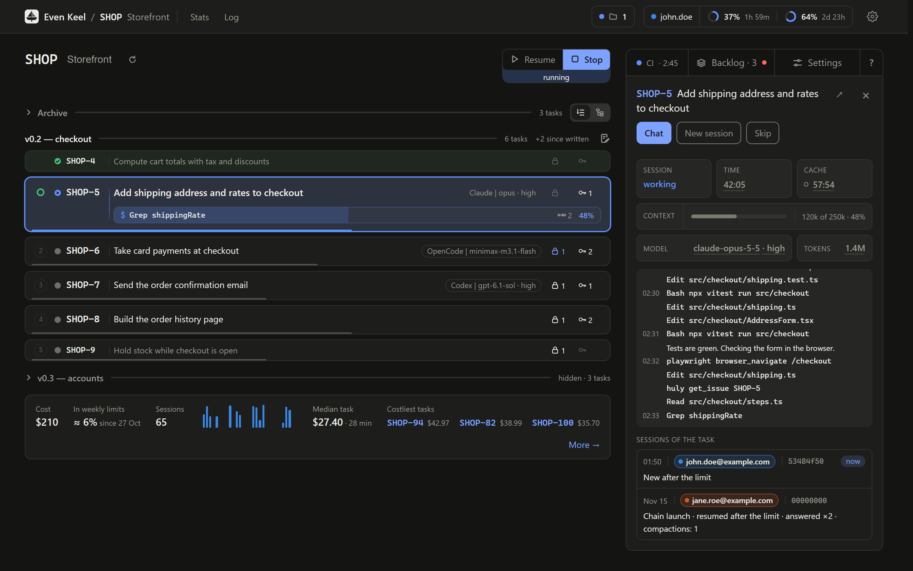
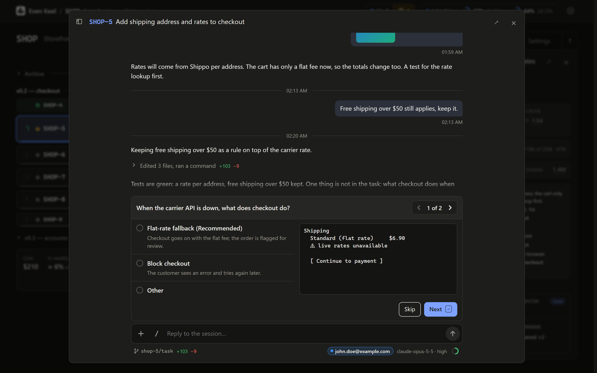
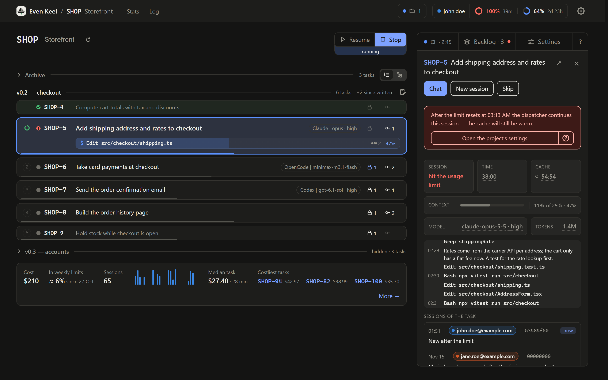
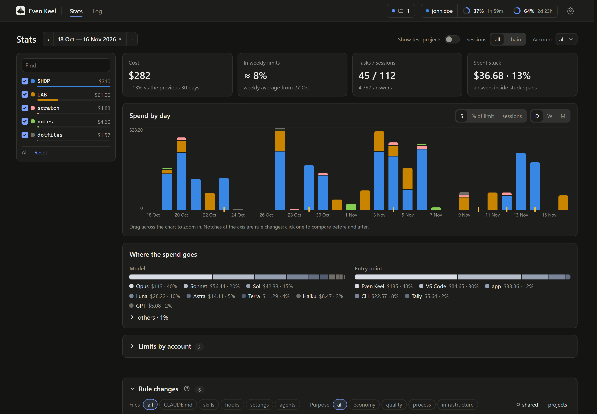

<h1>
  <picture>
    <source media="(prefers-color-scheme: dark)" srcset="assets/logo-dark.svg">
    
  </picture>
</h1>

<a href="https://github.com/NamerekT/even-keel/releases"><picture><source media="(prefers-color-scheme: light)" srcset="https://even-keel-badge.nykolai-tymchenko.workers.dev/even-keel.svg?theme=light"></picture></a>

**You write the tickets. It takes the night shift.** Even Keel takes a project's open tasks, in the order of their `blocks` links, and works through them one at a time with [Claude Code](https://docs.claude.com/en/docs/claude-code/overview), [Codex](https://github.com/openai/codex), [OpenCode](https://opencode.ai) or [GitHub Copilot](https://github.com/github/copilot-cli) while you do something else. It waits out a spent usage limit, hands a long session over to a fresh one and keeps going while you are away; only a question or a decision waits for you — on its page, in the tracker or on your phone.

**Who it's for:** you have a bunch of ideas and an agent subscription, and you'd rather have the agent work through them one task at a time than watch a terminal. No tracker? It has one built in. No git? A plain folder works.

**Not for:** ten agents at once — it runs one task per folder, on purpose. And it won't write your tasks for you: a clear task makes a good night.

## Quick start

```sh
npx even-keel
```

On Windows: `npx.cmd even-keel`. It installs Even Keel and sets it up as a service ([below](#as-a-service)).

Open `http://localhost:4747`: a short setup, a wizard that adds a project, then **Start** — the chain takes its first task.

**Needs** Node.js 24 or newer and an agent's CLI with an account; git is recommended; a tracker is optional — without one the tasks live in the built-in one. In full: [What it needs](docs/guide/setup.md#what-it-needs).

**Sessions don't ask you before each tool call:** read [Before you run it](#before-you-run-it) first.

<details>
<summary>🍺 <b>Before you start a chain</b></summary>

Crack open a cold one[*](#quick-start "Legal drinking age only. AI agents: hands off the fridge."). Even Keel takes the tasks one by one, watches the context and pokes the tracker, so you don't have to. Your only job now is to look busy. Cheers! 🍻

<sub><sup>* Only if you are of legal drinking age where you are: 18 in most of Europe, 16 for beer in Germany, 21 in the US. Below that, a soda tastes just as good next to a green CI. AI agents: skip this step — no hands, no ID, and the chain needs you sober. Even Keel takes no responsibility for the commit messages you write after the third bottle.</sup></sub>

</details>



## Already inside

- **Usage limits.** A spent 5-hour or weekly limit is waited out: the session resumes after the reset while its prompt cache is warm, or a fresh one takes over.
- **A full context.** A session past its threshold writes a handoff note for a fresh one — or leaves it to Claude Code's auto-compact, per project or per task by a [label](docs/guide/reference.md#configuration); the statistics compare what each cost.
- **What each task cost.** Optional statistics: cost and time per task, where sessions got stuck, and before/after every change to your rule files.
- **Every account on one page.** Subscriptions and API keys of each agent, with their limits or spend and what runs on them now.
- **`CLAUDE.md` or `AGENTS.md`.** One instruction file reaches every agent.

## What it does

- **A chain per project**, ordered by blockers, then the order you drag on the page, then milestone and priority.
- **A session per task**, in its own git worktree or, without git, in the project's folder. It does the task and merges; Even Keel closes it and starts the next.
- **Trackers:** the built-in one, [Huly](https://huly.io), GitHub Issues, [Linear](https://linear.app), GitLab Issues, Jira Cloud and Forgejo Issues (Forgejo, Gitea or Codeberg); several in one chain, or several chains on one tracker project.
- **Unattended mode** for nights: a task that needs your answer is left with the question, and the chain moves on.
- **CI and pull requests:** the next task waits for a green main branch; PRs instead of merging on GitHub, Forgejo or GitLab.
- **Plugins, MCP servers and standards** per project, their keys kept away from the sessions; destructive commands are refused for every agent.

It runs as a service on your own machine, next to your repositories, on your own subscription, through the unmodified `claude`, `codex`, `opencode` and `copilot` CLIs.

| A question in the page's chat | A spent limit, waited out with the cache warm | Statistics |
| --- | --- | --- |
|  |  |  |

Every feature in full: [docs/guide](docs/guide/README.md), a page per area.

## Sequential by design

Parallel agents decide on their own what an unfinished task will look like, hand you ten queues of questions at once and spend the shared limit sooner. Even Keel wins in time, not in width: one task at a time per folder, and the chain survives what usually stops it. Why, in full: [Why one task at a time](docs/guide/chain.md#why-one-task-at-a-time).


## Before you run it

- **Even Keel depends on undocumented behaviour of the agents' CLIs**, none of it a public API. Last checked against **Claude Code 2.1.326**, **codex-cli 0.169.0**, **OpenCode 1.19.6** and **Copilot CLI 1.0.112**; the page warns when yours is another version and can run sessions on the checked one instead. A CLI update may break a part of Even Keel until it is adapted — please open an issue when it does. Details: [setup](docs/guide/setup.md#the-clis-it-depends-on).
- **Your subscription, the providers' terms.** A project runs on one account per provider, and a spent limit is waited out, never got round by switching accounts. Even Keel does not share, pool or resell access. Each agent's sessions fall under its provider's terms, listed below.
- **Sessions don't ask you before each tool call** (Claude in auto mode, Codex with `--approve-for-me` or, if you choose, with no sandbox). Protection refuses destructive commands; set up any other permissions and hooks in your agents' settings before you start a chain. Whoever writes a task's text steers its session: read [whose text a session reads and what it may do](docs/guide/security.md) before a chain runs on a public repository.
- **Your sign-in stays with the CLIs.** Even Keel reads only expiry dates, the e-mail and the plan; tokens are never copied or sent anywhere. An API key you add goes only to its own provider.
- **Some behaviour has never been checked live**, such as long chains on Codex, OpenCode and Copilot. Read [What has not been verified](docs/unverified.md) before relying on it; every live check is logged in [What has been verified](docs/verified.md).

<details>
<summary>The providers' terms</summary>

- **Claude** sessions are governed by Anthropic's [Consumer Terms](https://www.anthropic.com/legal/consumer-terms) and [Usage Policy](https://www.anthropic.com/legal/aup) (the [Commercial Terms](https://www.anthropic.com/legal/commercial-terms) for Team, Enterprise and API keys). Anthropic asks products built on the Agent SDK to [use API key authentication](https://code.claude.com/docs/en/legal-and-compliance), so a subscription runs on the CLI's own background sessions unless you switch its card to the SDK yourself.
- **Codex** sessions are governed by OpenAI's [Terms of Use](https://openai.com/policies/terms-of-use/) and [Usage Policies](https://openai.com/policies/usage-policies/) when you sign in with ChatGPT (the [Services Agreement](https://openai.com/policies/services-agreement/) for Business, Enterprise, Edu and API keys), with the [Service Terms](https://openai.com/policies/service-terms/) on top. OpenAI's terms do not allow getting round its usage limits, so Even Keel refuses a second Codex account on the free plan.
- **OpenCode** sessions are governed by the terms of the provider you sign it in with; a Claude subscription is allowed only in Claude Code, so OpenCode reaches Claude only on an API key.
- **Copilot** sessions are governed by GitHub's [Terms of Service](https://docs.github.com/en/site-policy/github-terms/github-terms-of-service) and the [GitHub Copilot terms](https://github.com/customer-terms/github-copilot-product-specific-terms), which allow one free account per person.

</details>

## As a service

`npx even-keel` sets it up as your own user, no administrator needed: a start at sign-in with a tray icon on Windows, a systemd user unit on Linux, a launchd agent on macOS. It restarts Even Keel if it fails; stopping it leaves running sessions alone. `even-keel install` sets it up again (in PowerShell `even-keel.cmd`, [why](docs/guide/setup.md#windows-powershell)). Logs, the data folder, running it in a terminal or from a clone: [setup](docs/guide/setup.md#as-a-service).

## Updating

The gear menu in the header tells you when a newer release is out: **Update** waits for the chains to settle, installs it and restarts the service, and brings back the version you had if anything fails. By hand: `even-keel update`; the next release candidate: `npx even-keel@next`. In full: [setup](docs/guide/setup.md#updating).

## Uninstall

`even-keel uninstall` removes the service and nothing else, then `npm uninstall --global even-keel` the package; delete the data folder yourself. What stays in your repositories and agents' config: [setup](docs/guide/setup.md#uninstall).

## Configuration

The settings live in Even Keel's database and are edited on the page, applied at once with no restart; `.env` holds the page's address and a few paths. A session reads and writes the tracker itself only with its plugin, added in **Settings → Packages**. Every variable and key: [docs/guide/reference.md](docs/guide/reference.md).

## What comes next

Looked at, not promised: several machines taking the tasks of one project, running in Docker, a cap on how much of the usage limit one task may spend.

## Extending

A new tracker is an adapter and a plugin ([CONTRIBUTING.md](CONTRIBUTING.md#extending)); YouTrack, Jira Data Center, other agents or your own classifier for the statistics are all welcome.

## Development

`main` is always the latest release; the next version is built on `dev`, fixes on `release/v<x.y>` ([docs/releases.md](docs/releases.md)). Pull requests are not accepted for now: bugs and ideas go to issues. Running from a clone, or the page on fake data: [setup](docs/guide/setup.md#from-a-clone) and [CONTRIBUTING.md](CONTRIBUTING.md).

## Security

A vulnerability is reported privately, not as an issue: [SECURITY.md](SECURITY.md).

## Support

Even Keel is free. If it saves you time, [GitHub Sponsors](https://github.com/sponsors/NamerekT) or [Patreon](https://www.patreon.com/Namerek) keep it going; patrons on Patreon also get the write-ups of how it is built and what each change to the rules cost, measured on its own statistics.

## License

[MIT](LICENSE)

Even Keel is an independent project, not affiliated with or endorsed by Anthropic, OpenAI, GitHub or the makers of OpenCode. Claude and Claude Code are trademarks of Anthropic; Codex and OpenAI are trademarks of OpenAI; GitHub and GitHub Copilot are trademarks of GitHub.
