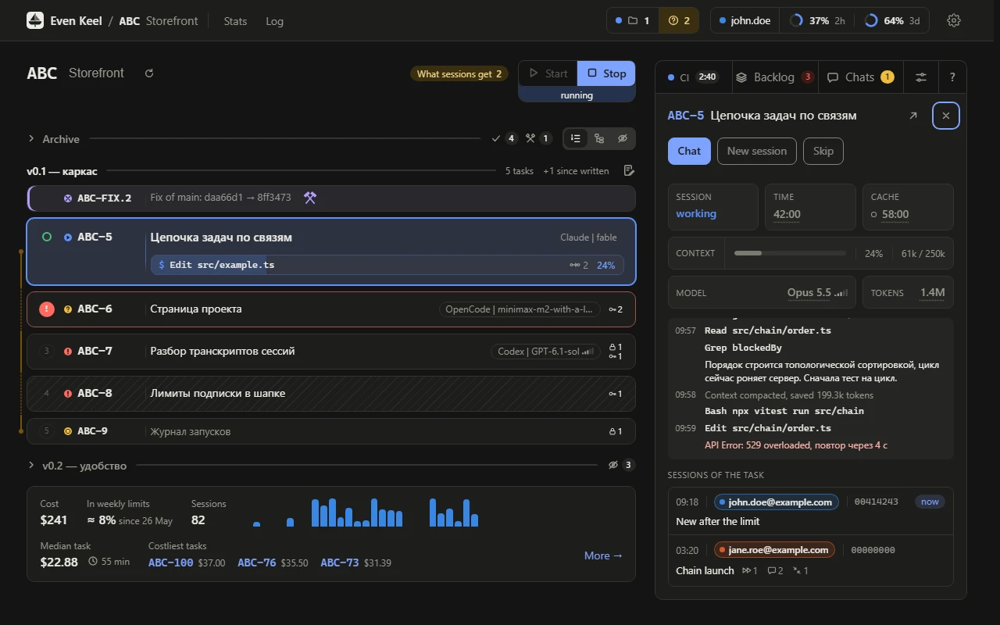
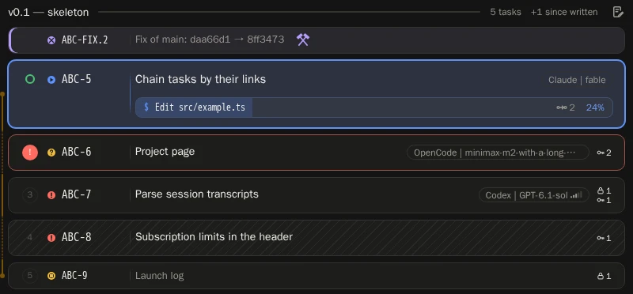

# The page

Everything is driven from one web page: the chains, the sessions, the accounts and the settings. This part of the guide walks through what you see there — a project's chain, task cards, notices, the event log and the status screen — and ends with the smaller things: hotkeys, the language, the theme and the tray icon. The chat with a session has [a page of its own](chat.md).

- [The project page](#the-project-page)
- [Task cards](#task-cards)
- [Notices and warnings](#notices-and-warnings)
- [The event log](#the-event-log)
- [Status](#status)
- [Updating from the page](#updating-from-the-page)
- [Reporting a problem](#reporting-a-problem)
- [In the tray (Windows)](#in-the-tray-windows)
- [Hotkeys](#hotkeys)
- [Languages](#languages)
- [Theme](#theme)
- [Small things](#small-things)

## The project page

### The legend

The **?** tab after **Settings** at the right of the project page opens a legend beside the chain, so you can check one against the other. It is grouped by location — the header, project row, tabs, task card and session strip — and says what each lamp and shape of a row means and each sign of the header that has no words on it: the limit rings, the account dot, the gear. Its queue and account samples match the header. It explains task states separately from priority numbers, dependency counters, the cache ring, release-carry agents and context usage.

State marks have different shapes as well as colours. Fix and release-carry rows show their state beside the row key.

### A task's row in the chain

A task's row in the chain shows its live session: a ring for the prompt cache that drains until it goes cold, the context with its percent in blue, amber or red by its level, the account's initial when the session runs on an account other than the project's, and a counter of context resets — every handoff plus every compaction of the agent's own — hidden while there are none; a closed task keeps that counter on its archive row.

### The archive

The **Archive** line above the chain holds the project's closed tasks of every milestone and age, the last closed nearest the chain. Press it to open the latest page and **N more** for older ones; on the built-in tracker, Huly and GitHub the older pages are read from the tracker as you ask for them, and the pressed button spins meanwhile. Huly and GitHub keep no closing time, so there the older pages go by the last change of a task. A link to a closed task opens the archive down to it. On Linear, Jira, GitLab and Forgejo the archive holds only the closed tasks of milestones that still have open ones and those the chain ran in the last week.

While the session works, the title has the first line to itself and the second is one field: what the session is doing right now, filled up to the context level with a clear edge, the percent, resets and initial at its end; on the current task's row the cache ring stands left of the lamp.

A session that waits for a reply, rests or has stopped keeps the row on one line, with the context as a small bar.

Point at a part for its figures: the minutes left in the cache, the tokens, the account's e-mail, the resets by kind.

A finished session's context figure uses its recorded window, or the last window the service observed for it.

The service remembers windows for up to 2000 sessions across restarts. If the agent has not reported a window, or an older session's window has expired from this history, the page shows the token count alone.

## Task cards

A click on a task's title opens its card: the description and comments rendered from Markdown (on Huly with the replies of a comment's thread under it), labels with what each means to the chain, milestone, priority, and the tasks it blocks, waits for or relates to.

A task number such as `ABC-12` in a description, comment or journal entry opens that task's card. You can refer to tasks from any project or feed configured in Even Keel. Numbers in code, addresses and link labels keep their original formatting.

The milestone on the card is a pick: choosing another one moves the task there in the tracker at once, and the chain reorders. Tracker changes reach the page on the next poll, every 30 seconds; the refresh button in the project head reads the tracker now.

### Into the chain and back to the backlog

**Into the chain** takes a backlog task in — from its card, straight from the backlog panel or, when it holds a chain task, from its locked row in the chain — so the phone rarely needs the tracker's own page: it puts on the first required label if the task has none and moves it out of a backlog status where the tracker has one.

**To the backlog** is its mirror, in the card and on a chain row you point at: it takes the required labels off and moves the task to a backlog status where there is one. It is not offered while a session works on the task.

On GitHub and GitLab, which have no backlog status, the backlog is the open issues without a required label, so the two buttons only put that label on and take it off. An outsider's issue in a public repository waits for **Into the chain** even with no required labels ([Whose text a session reads](security.md#github-gitlab-and-forgejo)).

### The backlog panel

The backlog panel shows a task's provider and model next to its key when its card set them, and has a search field under its head: it keeps the tasks whose key, title, provider and model or milestone hold every word typed, and Escape clears it before it closes the panel.

A long backlog shows its first 50 tasks and a **More** button for the next 50.

### Outside the chain

The crossed-out eye in the switch above the chain shows the open tasks that are neither in the chain nor in the backlog: those with an excluding label (such as `Manual`), those in a milestone the project's rules leave out, and those in a status the rules count as closed while the tracker still has it open. They are grouped by that reason, inside a group by milestone and inside a milestone by status, from In Review down to Backlog; a task with several reasons goes under the first in that order. A row's dot is its status's colour, its name in the tip. The order switch next to the view switch sorts the tasks of each status: newest first, oldest first or by priority; the view keeps its own choice, apart from the backlog's. Closed tasks the label or the milestone kept out go into the folded **Archive** at the top, the last closed first, with **older** for more; it is shown only when there are any. A status changed in the card moves the row at once. The milestone group starts folded, since it is mostly old milestones' leftovers, and the page remembers which groups you folded, per project on this device. A group shows 50 tasks and then **Show more**. A row only opens the task's card: to bring a task into the chain, take its label off or change its milestone there. The view reads the tracker each time you open it.

## Notices and warnings

Notices under the header stay with it as you scroll, with a dividing line between them. The project settings panel leaves room for them and keeps its save button in view.

When there are many notices, their area scrolls separately. Notices slide open and closed; reduced motion in your system settings disables that animation.

### Closing warnings

Every banner and project band has **Got it**: it hides that band on every device until what it says changes — another verdict of a remote, another CLI version, another error.

A warning also has **Don't show again**, which turns that kind of warning off: for the project, when the band is a project's, or for all of Even Keel.

Settings → **Notices** lists the kinds with a switch each and turns back on what was turned off; a project's own Notices tab can show or hide its kinds over the shared choice.

Errors that stop a chain, such as a broken config, only take **Got it**.

### Notifications in the corner

What waits for you also gets a notification in the corner while the page is open — a chain stopped on the usage limit, a red main, a session's question, a release carry that hit a conflict, a task that left the chain with its work not committed or not merged — with **Open** to the project.

CI failures give one notification per project and commit, naming the failed CIs and updating in place when another fails. A closed notification returns only if a newly failed CI now holds the chain; an optional CI failure alone does not bring it back.

An error on a card says what to do, and where a setting, an access profile or an account fixes it, a button under it opens that place.

In a session's usage-limit notice, press the **?** attached to the project settings button for the account and instructions on starting sooner.

Press it again, press Escape or click outside to close the tip. The notice shows only the latest message; the agent's own limit message is also the last line of the session's activity.

A carry conflict's notification goes away once an agent is assigned, and a conflict assigned automatically gets no notification. If you **Skip** the agent's session while the conflict remains, the notification returns.

## The event log

**Log** in the header is the event log: launches, stops and settings changes, questions, usage limits and accounts whose limits cannot be read, a red main, a carry conflict, work left in a folder, a chain paused on an error, a project's package problems, a CLI on a version Even Keel was not checked against.

Even Keel writes it also while no page is open and keeps the last 3000 entries.

A warning that goes away and comes back later is a new entry.

A warning or an error that comes while the page is open shows in the corner for 12 seconds of the tab in sight — a hidden tab holds it until you come back — and stays in the log.

The count next to **Log** is what this browser has not seen there yet, red when one of them is an error; opening the log marks it all read.

Each entry names the task or project it is about in a column of its own, a link to it.

Above the log, choose a level, category or project to narrow the entries; combined choices must all match. A level shows itself and everything more serious: **Warnings and errors** or **Errors only**.

**Reset** clears the choices, and an empty result offers **Reset filters**.

Filters are kept in the page address, so a copied link or a reload keeps them.

Opening a filtered log still marks the whole log read; notifications and the unread count follow the whole log too.

## Status

The gear in the header has a dot when something is wrong and a **Status** row leading to `/status`, one screen: a line on top that says all is well or names the problems with a button for the first, a tile each for the service itself, the reading of the limits, the settings and the statistics collector, and a card per tracker account in use — whether it answers and when it last did, its error in plain words, the projects and task feeds it reads (those not read for a while marked), a **Check** button that reads them now and **Open profile**.

## Updating from the page

A newer release gets a mark next to the version in the gear menu and a notification; both open the update window ([From the page](updating.md#from-the-page)).

## Reporting a problem

**Report a problem** in the gear menu, above the version (on a phone, in the menu button's sheet), leads to Even Keel's repository on GitHub, in a new tab:

- **Bug** — the bug form;
- **Broke after a CLI update** — the form for a part an agent's CLI update broke;
- **Can't get it installed** — the short form for a stuck setup or first run;
- **Question or idea** — the repository's Discussions.

The forms come with your Even Keel version and the version of each agent's CLI your sessions run on already filled in; the OS and the other choices are yours to pick. Nothing is sent by itself: you see the form, fill in the rest and decide. Even Keel collects no telemetry, so this is the only way it learns something broke.

A vulnerability goes privately, not as an issue: the last line, **privately only**, opens a private security advisory ([SECURITY.md](../../SECURITY.md)).

## In the tray (Windows)

On Windows `even-keel install` puts Even Keel's icon in the tray, with a dot for its state and a menu ([Windows: a start at sign-in](service.md#windows-a-start-at-sign-in)).

## Hotkeys

On a project page Ctrl+Enter (Cmd+Enter on a Mac) starts the chain, or resumes it from a pause; a running chain is left as it is.

A double click on a chain task opens its card.

Keys do nothing while you type in a field or a window is open, except the chat's own: Ctrl+B (Cmd+B) opens and closes the task panel even while you type a reply, and it never takes Enter, which the reply box keeps.

In the settings and in a tracker's window Ctrl+S (Cmd+S) saves, like the save button, even while you type in a field; with a tracker's window open over the project settings it saves the window. Ctrl+Z steps back the last field you changed in the open section, and Ctrl+Shift+Z (or Ctrl+Y) brings it back, until you save; in a text field they undo and redo the typing as usual. Undoing all the changes at once stays a button.

**Hotkeys** in the gear menu (not on a phone, which has no keyboard) shows them and changes the combination: it turns down one taken by another action or by the settings' fixed keys, a bare key other than F1–F12, and the ones a browser keeps for itself, such as Ctrl+W.

The layout belongs to this browser: another browser, a private window or another address of the page (`localhost` and `127.0.0.1` count as two) starts from the defaults.

## Languages

The page is in English or Russian; the prompts Even Keel sends to sessions can be in either, separately.

## Theme

The page is light or dark. **Settings** → **Interface** → **Theme** and the gear menu (the menu button on a phone) offer **System**, **Light** and **Dark**.

**System** is the default: the page follows your device's theme and changes with it on the fly. The choice is kept in this browser only, so a phone and a desktop can each have their own.

## Small things

Help tips close when you scroll the page or another area outside the tip, or resize the window. Scrolling inside a tip keeps it open.

The page loads its initial data through its live connection and then receives only changes.

A button's busy mark ends when the service acknowledges the command; its result appears when the live update arrives.

If the connection breaks, the page keeps its last data and reconnects. Reloading and reconnecting fetch a complete snapshot; commands are never repeated automatically.

Large data responses and live updates are compressed when the browser supports gzip.
